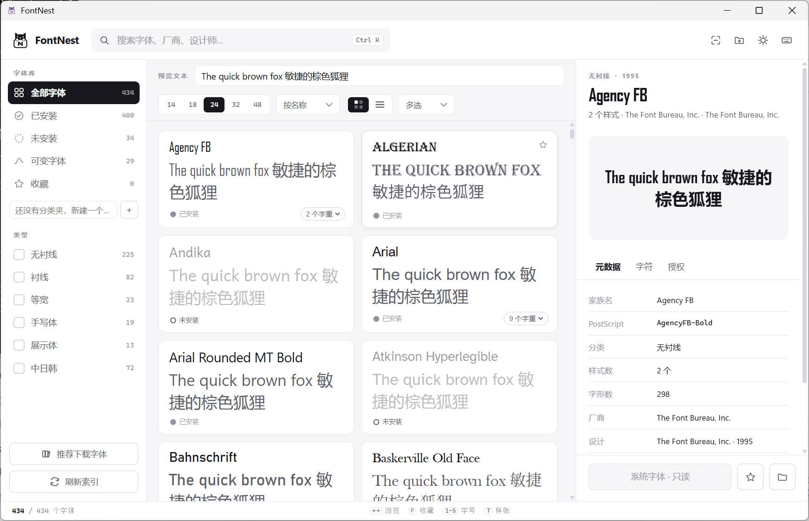
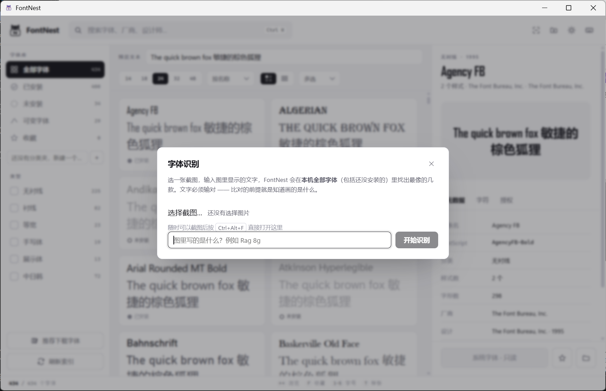
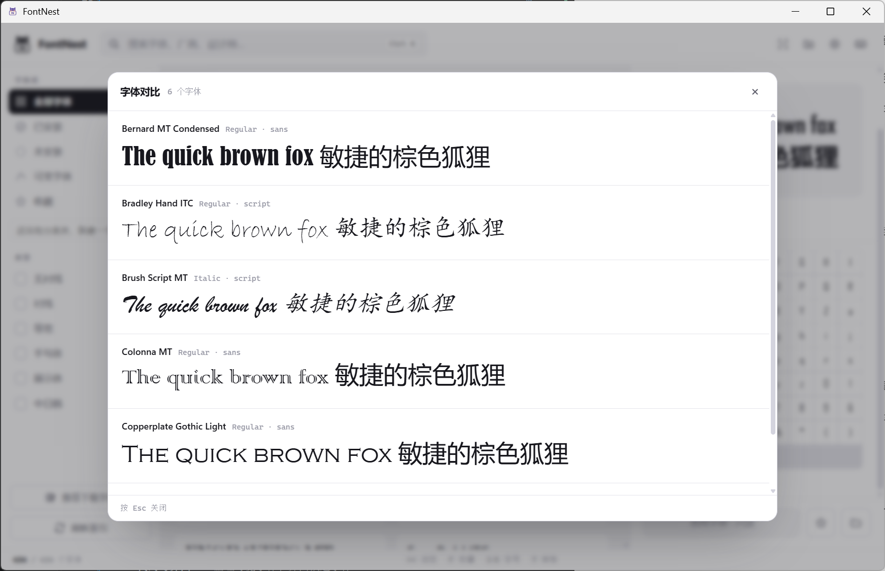
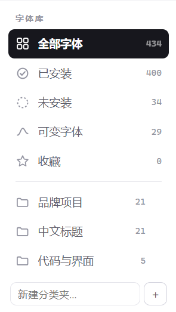

<div align="center">


<h1>FontNest</h1>

<p><strong>截图找字体，细看每个字，选出最合适的那一款。</strong></p>
<p>本地字体工具 · 截图识别 · 字符预览 · 字体对比 · 分类整理</p>

<p>
  <a href="https://github.com/C0P1Fur/FontNest/releases"></a>
  <a href="#下载安装"></a>
  <a href="https://v2.tauri.app/"></a>
  <a href="https://react.dev/"></a>
  <a href="#许可证"></a>
</p>

<p>
  <a href="https://github.com/C0P1Fur/FontNest/releases/"></a>
</p>

<p><a href="https://github.com/C0P1Fur/FontNest/releases">全部发布版本</a> · <a href="#界面预览">界面预览</a> · <a href="#从源码编译与运行">源码构建</a></p>

</div>

看到喜欢的字体，却不知道叫什么？FontNest 可以根据文字截图，在你的本地字库中寻找相似字体。

找到候选后，查看字母、数字和汉字的细节，再用同一段文字对比多款字体，最后将选中的字体收进分类夹。让找字体、选字体和整理字体连成一套顺手的流程。

> 当前主要提供 Windows 使用教程。预览版仍在完善中，功能限制见下文。

## 下载安装

**当前预览版仅保证Windows用户能够成功下载安装**

**[点击下载 FontNest](https://github.com/C0P1Fur/FontNest/releases)**

1. 下载 EXE 安装程序，双击运行并按向导完成安装；EXE 和 MSI 任选一种即可。
2. 从开始菜单启动 **FontNest**。
3. 等待首次字体扫描完成，即可浏览本机字体或添加自己的字体目录。

安装发布版不需要 Node.js、pnpm、Rust 或 C++ 构建工具。如果启动时提示缺少 WebView2，请安装 [Microsoft WebView2 Evergreen Runtime](https://developer.microsoft.com/en-us/microsoft-edge/webview2/)。

## 界面预览

<p align="center">
  
  <br>
  <em>实际 Windows 桌面版截图，展示本机字体扫描结果。字体种类和数量取决于你的电脑。</em>
</p>

## 核心功能

### 截图识别字体

看到海报、网页或设计稿里喜欢的字体，不必再挨个翻找字库。

选一张文字截图，输入图中显示的文字，FontNest 会在已扫描的本地字体中寻找相似候选，包含尚未安装的字体。

**使用方式：**

1. 点击顶栏的“字体识别”，选择图片；也可以将截图复制到剪贴板，在应用运行时按 `Ctrl+Alt+F`。
2. 输入截图中的文字，点击“开始识别”。
3. 查看候选字体，并进入详情进一步确认。

<p align="center">
  
  <br>
  <em>选择截图，输入文字，即可开始本地字体比对。图片展示的是识别入口。</em>
</p>

### 字符预览

一段样张能看出整体风格，但真正影响选择的，常常是某个字母、数字或标点的细节。

<p align="center">
  
</p>

选中字体后，打开详情面板的 **“字符”** 标签，即可用当前字体查看预设字符网格，观察字形结构、笔画和比例。

- 比较大小写字母的造型，观察字体的个性。
- 查看数字和常见符号，判断是否适合界面、标题或正文。
- 对包含中文样本的字体，观察代表性汉字的结构。
- 配合样张预览和字体元数据，进一步判断是否适合当前设计。

当前字符面板展示的是预设样本，并非完整 Unicode 字符表；实际显示效果取决于字体的字符覆盖范围。

### 字体对比

几款字体单独看都不错，放到一起才容易看出差别。

<p align="center">
  
</p>

FontNest 支持同时对比 **2–6 个字体族**，使用相同的样张文字和字号逐行展示，让注意力集中在字形本身。

**使用方式：**

1. 在主界面设置想比较的样张文字和字号。
2. 进入多选，选择 2–6 个字体族。
3. 点击“对比”，在同一面板中查看不同字体的表现。

可以把实际要用的标题或正文设为样张，直接判断哪款字体更适合当前内容。

对比以字体族为单位，每个字体族优先使用 Regular 样式；当前不是同一字体族内的多字重对比。

### 容器分类

按项目、用途或风格建立分类夹，把需要的字体放在一起，下次使用时直接进入对应分类。

<p align="center">
  
</p>

例如：

- **品牌项目**：整理品牌标题、正文和辅助字体。
- **中文标题**：集中收纳适合海报与封面的字体。
- **代码与界面**：整理等宽字体和界面候选字体。

左侧的“全部字体”等内置视图与自定义分类夹，都是独立的浏览入口。进入某个容器后，再用搜索和类型筛选缩小范围。

**使用方式：**

1. 在左侧新建分类夹。
2. 将选中的字体添加到分类夹。
3. 点击分类夹，浏览和筛选其中的字体。

分类只整理字体的归属关系，不移动原文件，也不会因为加入分类夹而自动安装字体。

### 日常管理同样齐全

- **扫描与预览**：扫描系统字体和自定义目录，预览未安装字体。
- **搜索与筛选**：按字体信息查找，结合类型和状态筛选。
- **收藏**：快速标记常用字体。
- **启用与停用**：在 Windows 当前用户范围安装字体，管理由 FontNest 安装的副本。
- **明暗主题**：根据使用环境切换界面主题。

## 平台支持与限制

本文主要面向 Windows。v0.1.0 发布页还提供 macOS Apple Silicon 和 Linux x64 构建产物；这些产物的存在不代表各平台功能完全一致，本文尚未验证其安装与运行情况。

使用前请了解：

- 支持扫描 `.ttf`、`.otf`、`.ttc` 和 `.otc`；暂不支持 WOFF、WOFF2 等网页字体格式。
- 系统字体作为只读内容展示；停用操作只管理 FontNest 自己安装的字体。
- 截图识别依赖本地字库，无法找出本机没有的字体。
- 识别时必须手动输入截图中的文字，不会自动识别文字内容。
- 干净、清晰的单行文字图效果更好；复杂背景、模糊、透视和特殊字间距可能影响结果。

## 从源码编译与运行

**仅使用软件，请优先下载上方预览版。以下步骤面向需要修改代码、调试或自行构建的用户。**

下面的命令使用 Windows PowerShell。除环境安装步骤外，请在项目根目录执行，即同时包含 `package.json`、`Cargo.toml` 和 `src-tauri` 的目录。

首次安装依赖和编译需要联网，Rust 首次编译可能耗时较长。

### 1. 准备开发环境

需要准备：

- **Git**：用于获取源码。通过 GitHub 下载源码 ZIP 时可跳过。
- **Node.js 24.x**：包含 npm，用于安装依赖和构建前端。这里选择 24.x，与当前锁文件中的 Vite、Vitest 版本要求兼容。
- **pnpm 11.x**：项目使用这一版本系列的依赖构建脚本配置。
- **Rust stable，MSVC 工具链**：用于编译桌面程序。项目尚未声明经过验证的最低 Rust 版本。
- **Microsoft C++ Build Tools**：需要“使用 C++ 的桌面开发”工作负载。
- **Microsoft Edge WebView2 Runtime**：用于显示桌面界面，很多 Windows 电脑已预装。

#### 安装 Git 和 Node.js

分别从 [Git 官网](https://git-scm.com/downloads/win)和 [Node.js 官网](https://nodejs.org/en/download)下载安装程序。

Node.js 选择 **24.x**。安装完成后重新打开 PowerShell，检查：

```powershell
git --version
node --version
npm --version
```

每条命令都应输出版本号，其中 Node.js 应为 `v24.x.x`。

#### 安装 pnpm

使用 npm 安装指定主版本，避免直接安装其他主版本：

```powershell
npm install --global pnpm@11
pnpm --version
```

版本号应以 `11.` 开头。安装方法也可参考 [pnpm 官方文档](https://pnpm.io/installation)。

#### 安装 C++ 构建工具

下载并打开 [Visual Studio Build Tools](https://visualstudio.microsoft.com/visual-cpp-build-tools/) 安装程序：

1. 选择 **“使用 C++ 的桌面开发”**。
2. 保留该工作负载中的 MSVC 编译工具和 Windows SDK。
3. 完成安装；如果提示重启，请先重启。

如果已经安装 Visual Studio，可在 Visual Studio Installer 中检查是否已安装该工作负载。

#### 安装 Rust

从 [Rust 官网](https://www.rust-lang.org/tools/install)下载并运行 `rustup-init.exe`，使用适合本机架构的 MSVC 工具链。

安装后重新打开 PowerShell：

```powershell
rustup default stable-msvc
rustc --version
cargo --version
rustup show active-toolchain
```

最后一条输出的工具链名称应包含 `windows-msvc`。

#### 检查 WebView2

如果电脑已有 **Microsoft Edge WebView2 Runtime**，无需重复安装。

如果没有，或应用启动时提示缺少 WebView2，请从 [Microsoft WebView2 下载页面](https://developer.microsoft.com/en-us/microsoft-edge/webview2/)安装 Evergreen Runtime。

C++ 工具、MSVC 工具链和 WebView2 的配置依据可参考 [Tauri Windows 环境准备文档](https://v2.tauri.app/start/prerequisites/#windows)。

### 2. 获取源码

在希望存放项目的位置打开 PowerShell。

克隆项目并进入源码目录：

```powershell
git clone https://github.com/C0P1Fur/FontNest.git FontNest
cd FontNest
```

也可以通过 GitHub 的 **Code → Download ZIP** 下载源码，解压后在包含 `package.json` 的文件夹中打开 PowerShell。

确认当前目录正确：

```powershell
Get-Item package.json, Cargo.toml, src-tauri
```

应显示这三个文件或目录，而不是“找不到路径”。

### 3. 安装项目依赖

```powershell
pnpm install --frozen-lockfile
```

此步骤安装前端依赖和项目使用的 Tauri 命令行工具。Rust 依赖会在后续桌面编译时下载。

### 4. 启动桌面开发模式

希望先确认程序能正常运行，可以执行：

```powershell
pnpm desktop
```

该命令会自动启动前端开发服务并编译 Rust 后端，无需提前运行 `pnpm dev`。

成功后会打开 **FontNest 桌面窗口**，首次启动扫描本机字体，随后显示字体列表。运行期间保留终端；结束调试时在终端按 `Ctrl+C`。

这是开发模式，会编译调试版本，**不等同于安装应用**。

### 5. 编译正式版本

仅需要编译后直接运行，可以跳过安装器打包：

```powershell
pnpm tauri build --no-bundle
```

`--no-bundle` 会跳过打包步骤，但仍编译正式版本，详见 [Tauri CLI 文档](https://v2.tauri.app/reference/cli/#build)。

在默认构建目录、未指定额外目标平台的情况下，可执行文件位于：

```text
target/release/fontnest.exe
```

编译成功后运行：

```powershell
.\target\release\fontnest.exe
```

这个文件是**可执行程序，不是安装包**。启动它不需要保持 Vite 开发服务运行，但电脑仍需具备 WebView2 Runtime。

如果你配置了 `CARGO_TARGET_DIR` 或额外编译目标，产物目录会有所不同，请以构建日志为准。

### 6. 可选：自行生成安装器

当前配置已启用安装器打包。官方预览版可直接下载；以下命令用于生成包含你本地修改的安装器。

如果希望从源码生成 NSIS 安装器：

```powershell
pnpm tauri build --bundles nsis
```

默认输出目录为：

```text
target/release/bundle/nsis/
```

构建成功后，可打开目录，双击生成的安装程序：

```powershell
Invoke-Item .\target\release\bundle\nsis
```

当前 NSIS 配置使用当前用户安装模式，提供简体中文和英文界面。

项目的完整构建命令是：

```powershell
pnpm desktop:build
```

它会按照当前 `targets: "all"` 配置执行打包。在 Windows 上，MSI 打包可能需要额外系统组件；如果只需要安装使用，可以先选择上面的 NSIS 命令。

所有产物均需本机实际构建成功后才会生成，具体文件名以构建日志为准。

### 仅预览界面

如果只想查看或开发前端界面，在安装前端依赖后运行：

```powershell
pnpm dev
```

在浏览器打开：

[http://localhost:1420](http://localhost:1420)

浏览器模式使用内置 mock 数据，不读取真实本地字库，也不执行真实的字体安装、卸载或截图识别。

完整功能请使用桌面模式。

## 常见问题

### PowerShell 提示找不到 node、pnpm 或 cargo

先关闭并重新打开 PowerShell，让新安装工具的 PATH 设置生效，再运行对应的版本检查命令。

如果仍然找不到，请确认相关工具已经安装，并检查安装程序是否配置了 PATH。

如果提示无法运行 `npm.ps1` 或 `pnpm.ps1`，可以使用对应的命令入口，例如：

```powershell
npm.cmd install --global pnpm@11
pnpm.cmd install --frozen-lockfile
pnpm.cmd desktop
```

### 编译提示找不到 link.exe 或 Windows SDK

打开 Visual Studio Installer，确认安装了“使用 C++ 的桌面开发”、MSVC 工具和 Windows SDK。

同时检查：

```powershell
rustup show active-toolchain
```

工具链应包含 `windows-msvc`。环境修复后重新打开终端再编译。

### 安装依赖时提示 Node.js 版本不支持

使用前文推荐的 Node.js 24.x。

当前锁文件中的测试工具有更高的 Node.js 版本要求，仅满足 Vite 的最低版本并不足以覆盖整个项目的开发依赖。

### 提示 esbuild 构建脚本被跳过

确认使用 pnpm 11.x，并且项目根目录中的 `pnpm-workspace.yaml` 保留了：

```yaml
allowBuilds:
  esbuild: true
```

检查完成后重新执行依赖安装；必要时执行：

```powershell
pnpm rebuild esbuild
```

### 提示 1420 端口被占用

项目使用固定的 `1420` 端口。

如果已经运行了 `pnpm dev`，请先在那个终端按 `Ctrl+C`，再执行 `pnpm desktop`。桌面开发命令会自行启动前端服务。

### MSI 打包提示 failed to run light.exe

Tauri 的 MSI 打包可能需要启用 Windows 的 VBSCRIPT 可选功能，参见 [Tauri MSI 环境说明](https://v2.tauri.app/start/prerequisites/#vbscript-for-msi-installers)。

如果只是要生成可用程序或安装器，可以选择：

```powershell
# 只编译可执行程序
pnpm tauri build --no-bundle

# 只生成 NSIS 安装器
pnpm tauri build --bundles nsis
```

### 为什么没有显示我添加的字体？

请依次检查：

- 使用的是桌面版，而不是浏览器 mock 预览。
- 字体所在目录已添加，且已刷新索引。
- 文件格式属于支持范围。
- 当前搜索、分类或状态筛选没有将其隐藏。
- 字体文件仍存在，并且当前用户可以读取。

字体不包含样张中的某些字符时，这些字符可能由替代字体显示。

### 启用后，其他软件里为什么还没出现？

先确认 FontNest 显示安装成功。部分应用会缓存字体列表，需要重新打开字体选择界面或重启该应用。

### 截图识别为什么不准确？

优先使用背景干净、清晰、未变形的单行文字截图，并准确输入图中文字。

候选字体必须已经被 FontNest 扫描到；本机没有对应字体时，只能返回本地字库中相似的结果。

## 开发说明

项目使用 React、TypeScript、Vite、Zustand 和 Tauri 2，核心字体逻辑使用 Rust 编写。

```text
src/                    React 界面、状态管理与 IPC 封装
src-tauri/              Tauri 桌面壳、命令、快捷键与字体协议
crates/fontnest-core/   字体扫描、解析、安装、分类与识别
crates/fontnest-cli/    核心功能的命令行调试入口
assets/screenshots/    README 使用的真实桌面截图
```

核心 Rust 库不依赖界面，可通过 CLI 或测试单独验证。

在项目根目录执行：

```powershell
# TypeScript 类型检查
pnpm typecheck

# 前端测试
pnpm test

# 前端生产构建；不会生成桌面程序
pnpm build

# Rust 核心测试
cargo test -p fontnest-core

# 检查整个 Rust 工作区
cargo check --workspace
```

这些是验证命令，不代表当前环境已运行通过。

## 许可证

FontNest 采用 **MIT OR Apache-2.0** 双许可证，你可以选择其中之一，具体条款见：

- [MIT License](LICENSE-MIT)
- [Apache License 2.0](LICENSE-APACHE)

软件许可证不包含你自行导入字体的授权。字体的使用与分发请遵守对应字体的许可证。
